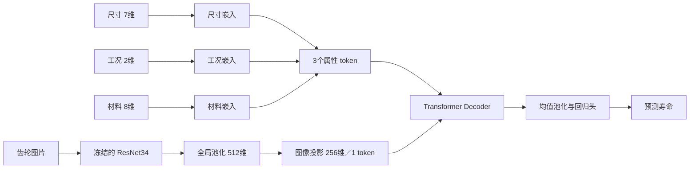

# 齿轮损伤识别与寿命预测：核查与学习说明

核查日期：2026-10-04。目标是修复本机原型的运行与训练代码隐患，保留历史权重和原始元数据，并分清程序能运行、模型是否有效、研究设计是否有证据这三件事。

## 1. 训练过更新模型，为什么界面仍用旧模型？

原 `DamagePredictor` 默认 `model_variant='original'`，桌面初始化没有传版本；统一命令行也默认 original。微调保存文件名为 `model_hongguan_updated.pth`、`model_tishijing_updated.pth`，但这并不能改变预测器的默认选择。

核查两对权重：每个模型有 220 个 state_dict 张量，两对原始/更新权重各有 220 个张量不同，分类头也不同。历史微调日志存在。以上支持“有更新后的模型文件”，不能独立认证每次训练的过程、日期或泛化提升。

已将 CLI 与桌面默认统一为 updated，保留 `--weights original` 作为明确的比较入口；初始化要求选定版本完整双文件，不自动降级。窗口、结果及 CLI JSON 显示版本与实际检查点。检查点相对文件名、大小、SHA-256 保存在 `checkpoint-audit.json`。

你可以把权重选择理解成一个独立的软件配置问题：模型在磁盘上更新，不会自动让所有调用者改用它。需要从界面入口一直追踪到实际 `torch.load`，再通过运行结果确认。

## 2. 修复清单与原因

| 发现 | 原因 | 本次处理 |
|---|---|---|
| 默认预测使用原始权重 | 训练文件名与推理默认配置脱节 | 默认 updated，显示实际文件，原始版本显式选择 |
| 已提供的照片出错后悄悄变为另一视角预测 | 宽泛捕获异常并置权重为 0 | 缺文件、损坏图片、缺模型明确失败；未提供视角才允许单视角 |
| 非法融合系数可产生非法概率 | 未检查负数、NaN、无穷或总权重 | 检查有限非负及正总和；CLI 使用单一宏观比例 |
| 分类必须先标定比例尺 | 分类与物理测量被绑定 | 未标定仍展示类别；物理测量提示先标定 |
| 双图仅一图标定时测量崩溃 | 当前图未标定但另一图已标定 | 测量切换到有标定和二值图的视角 |
| 寿命早停最佳权重随训练变化 | state_dict 浅拷贝仍共享张量 | deepcopy 保存独立快照 |
| 寿命跑满轮数保存最后一轮 | 只在触发早停时恢复最佳模型 | 正常结束和早停均在保存/测试前恢复最佳验证权重 |
| 冻结编码器仍改变 BN 缓冲 | model.train() 重新开启 BatchNorm 统计更新 | 编码器始终 eval；其余分支仍 train |
| 指定损伤权重加载失败仍继续 | strict=False 与失败后回退掩盖问题 | 检查完整 backbone 键与形状；指定文件失败即报错 |
| 寿命体视镜记录被套到宏观图上 | 读取时忽略路径中原视角 | 按记录原视角过滤；批量预测不跨视角或跨 train/test 寻找替代 |
| 测试集逐轮用于挑选分类模型 | train/test 被当作 train/val | ResNet、微调、VGG 仅用 val 挑选检查点 |
| 寿命同一实物可能跨划分 | 对记录随机划分，重复图片/多视角共用实物 | 再训练要求真实实物 ID、标签来源认证；按实物分组，并拒绝重复图字节 |
| 界面输出固定 0.85 的寿命置信度 | 常数没有校准或区间估计依据 | 删除固定置信度，标明来源未核验 |

本次没有改写原始 DATA.json，没有给未知标签或实物身份造答案，也没有改写历史成绩。分类加载器对无法解析到现存图片的记录会给出警告；数据审计报告仍须在任何新实验前复核。

## 3. 没有 CLIP，多模态设计合理吗？

代码中的另一种输入是 **17 维结构化属性**，并不是自然语言文本：尺寸 7 维、工况 2 维、材料 8 维。它们经各自 MLP 嵌入为 256 维，堆叠成 `[B,3,256]`，图像经 ResNet34 全局池化得到 512 维、线性投影为 256 维，成为 `[B,1,256]` 的 memory。

CLIP 是图像和自然语言的对比预训练方法，通过匹配图文对学习表示；它不是所有多模态融合必须经过的步骤。这里可以直接用寿命回归损失学习图像投影与属性分支之间的联合关系。所谓“统一维度”只保证张量可计算，不自动证明两类表示已对齐，也不证明融合优于单模态。

这里有一个数学上的限制。交叉注意力为：

\[
\operatorname{Attn}(Q,K,V)=\operatorname{softmax}(QK^T/\sqrt{d_k})V.
\]

图像只有一个 token，每个属性 query 的 softmax 都只有一个候选，权重为 1。推理时，每个属性 token 获得的是同一个经多头投影的图像信息；没有在图像区域之间进行选择。训练中的注意力 dropout 可随机屏蔽该项，但不会产生空间选择能力。不同属性仍可通过自注意力、残差、非线性和回归损失影响最终结果，因此模型有融合能力，不能称为有效的区域级图像注意力。

本次保留结构以兼容旧权重。改成多个空间 token 或另一个融合网络会改变模型，必须重新训练并做对比；不能只改网络后继续把旧检查点结果称为已验证的新结构。

参考：[CLIP 原论文](https://proceedings.mlr.press/v139/radford21a.html)、[Attention Is All You Need](https://papers.nips.cc/paper_files/paper/2017/hash/3f5ee243547dee91fbd053c1c4a845aa-Abstract.html)。单 token 注意力退化是根据公式和本项目张量形状得出的推论。

## 4. 尺寸、工况、材料直接拼接是否合理？

拼接本身是合理基线：它保留信息，让后续 MLP 学习非线性关系。重要的是量纲一致的处理、类别编码、缺失值和数据质量，而不是拼接这个操作是否足够高级。

你的寿命代码先把 17 个数值拼起来，用 StandardScaler **按每列**标准化，再拆回 7/2/8 三组；不是把毫米、MPa、转速直接视为同一量纲。标准化器只在训练子集拟合，验证/测试复用，这一点方向正确。进入 Decoder 前实际用的是三组独立嵌入后的 `stack`，不是无区别的一长串原数值。

三个分支各有不同可训练参数，已经带有属性类型信息；不需要给尺寸、工况、材料硬加时间先后顺序。没有位置编码本身不是错误。

仍需处理：

- 材料种类当前是“是否为一个指定牌号”的二元编码，其他牌号都为 0，无法区别多种材料；未来应使用明确词表、one-hot 或 embedding，并单独处理未知材料。
- 部分区间属性取平均，会丢失测量范围和不确定性；缺失属性默认为 0，会混淆真实零与缺失。
- 图片与属性必须来自同一被测齿轮。仅凭文件名配对没有物理身份保证。
- 17 维属性可能高度重复；应检查是否因工况/标签规则本身即可预测寿命，图像是否真正提供增益。

属性键（沿用原始格式）：

| 组 | 键 | 单位/含义 |
|---|---|---|
| 尺寸 | `moshu`, `chishu`, `bianweixishu`, `luoxuanjiao`, `yalijiao`, `chidingyuan(mm)`, `chikuan(mm)` | 模数、齿数、变位系数、螺旋角、压力角、齿顶圆直径、齿宽；原始角度单位需另核实 |
| 工况 | `edingniujiu(N*m)`, `edingzhuansu(r/min)` | 额定扭矩、额定转速 |
| 材料 | `cailiao`, `midu(g/cm3)`, `tanxingmoliang(MPa)`, `bosongbi`, `qufuyingli(MPa)`, `qianghuaxishu(MPa)`, `yinghuazhishu`, `mocaxishu` | 材料牌号、密度、弹性模量、泊松比、屈服应力、强化系数、硬化指数、摩擦系数 |

这些定义是输入协议，不代表原始属性和寿命之间的物理关系已经获证。

## 5. 为什么冻结参数？

寿命模型冻结 ResNet34 编码器，在 no_grad 内提取特征；图像投影、三组属性嵌入和 Decoder/回归头仍可更新。小数据下冻结能减少过拟合、训练计算和表示漂移，属于合理的起点；损伤分类微调脚本则使用较小学习率更新整个分类网络，二者不是同一种训练策略。

冻结的代价是编码器不能适应寿命任务可能需要的细微差异。如果可追溯数据增加，可比较完全冻结、只解冻 layer4、全量小学习率微调。

`requires_grad=False` 固定梯度更新；`no_grad` 不记录计算图；`eval()` 切换 BN/Dropout 行为。这三件事不同。原代码仍通过 `model.train()` 改变 BN running_mean/running_var，冻结并不完整。本次覆写模型 train 方法，将图像编码器保持 eval，测试确认梯度可到达投影层而不会到达图像编码器、BN 缓冲不会改变。

参考：[PyTorch autograd 说明](https://docs.pytorch.org/docs/stable/notes/autograd.html)、[BatchNorm2d 文档](https://docs.pytorch.org/docs/stable/generated/torch.nn.modules.batchnorm.BatchNorm2d.html)。

## 6. 融合权重能训练吗？

现在的分类概率融合是：

\[
p=0.3p_h+0.7p_t.
\]

代码中两项是函数参数，没有 nn.Parameter，也没有被优化器更新，所以它们目前不是训练出来的。

三种方案可以比较：

1. **固定比例**：实现简单、可复现、容易解释。0.3/0.7 可作为基线，但目前缺乏证据称它最优。
2. **验证集调比例**：在真实成对、标签可信的验证集上搜索 w∈[0,1]，根据 NLL、macro-F1 等预先指定指标选择；模型和权重确定后只报告一次独立测试。不要看测试成绩反复改 w。
3. **学习全局系数**：定义可训练 a，令 w_h=sigmoid(a)、w_t=1-w_h，最小化成对训练样本的负对数似然；也可以固定两个分类器，只训练这个融合参数。若用交叉验证，应以实物分组产生 out-of-fold 概率来拟合，减少对训练集过拟合。

如果输入图像质量差异很大，还可训练逐样本门控，但它增加复杂度和过拟合机会。当前数据少、配对身份未知，先保留固定比例与单视角基线更有解释价值。单视角时可用视角归一化为权重 1；显式设置其权重为 0 会报错。双视角输入的一张照片失败时明确报错，不再默默改变实验条件。

学习权重也不能补救错误配对、标签不实或两个模型概率尺度失衡。先在独立验证集检查校准，再比较权重方案。

## 7. 跑通到底证明了什么？

本机环境 Python 3.11.11、PyTorch 2.3.1、CPU，无可用 CUDA。完整 smoke check 覆盖两套分类权重、两种视角、四个类别各一张图片，共 16 次推理；概率有限且归一化；寿命推理输出有限值；桌面 10 个功能按钮初始化、默认 updated、寿命独立进程桥接及后续分类均可用。额外回归检查覆盖权重选择、异常输入、BN、最佳模型恢复、分组划分及部分标定场景。

这些检查不测独立准确率，不覆盖所有人工测量/选区操作，也不评估寿命模型的物理有效性。部分 smoke 图片来自训练目录，不能把预测正确当作泛化证据。没有开展新的全量训练。

原始图片 82 张、额外 16 张，总计 98 张；78 张原始图片通过文件和元数据一致性检查。旧寿命宏观加载器得到 58 条记录，其中 20 条来自体视镜记录被错误映射；修复后按宏观视角得到 38 条记录，仍包含同图不同寿命问题。原始元数据中的缺路径、冲突和寿命来源未认证保持待解决。

因此当前分类训练会因没有独立 val 分区停止；寿命再训练会因缺少可信标签和实物身份停止。这些门槛防止再次生成误导性的结果。旧检查点可演示，但不能用代码修复追溯性地纠正其历史训练泄漏。

## 8. 下一步怎样做可信实验？

先核实寿命是实测至失效循环数、物理仿真标签还是人工生成值；确认完整寿命还是剩余寿命，观测图片对应哪个时间点，以及是否存在未失效的删失样本。不同定义不能混为一个回归目标。

建立齿轮实物 ID 和拍摄配对，同一齿轮/试验批次整组划分；审查同图不同标签、视觉近重复、元数据路径错误。标准化只拟合训练集，验证集决定模型/阈值/融合系数，测试集留到最后。

随后在同一分组划分上比较：属性-only、图像-only、图像+属性拼接 MLP、现有单图像-token Decoder、多个空间图像-token 的注意力模型。再比较冻结范围和固定/调优融合系数。报告分组交叉验证的均值与波动，保留失败案例和不确定性；只有这样才能判断复杂结构是否值得。

## English scope note

The maintenance update preserves historical checkpoints and source metadata. It repairs default checkpoint selection, failure propagation, frozen BatchNorm behavior, independent best-weight snapshots and restoration, view/split fidelity, validation-only checkpoint selection, and specimen-group lifetime splitting behind provenance checks. The local desktop and inference checks establish operability, not generalization or physical validity. The current image/tabular architecture does not require CLIP, but its single image memory token cannot perform spatial selection. Fixed 0.3/0.7 fusion remains a baseline; learned weights require trustworthy paired data and independent validation. Data and checkpoints are local assets excluded from the public source repository.
